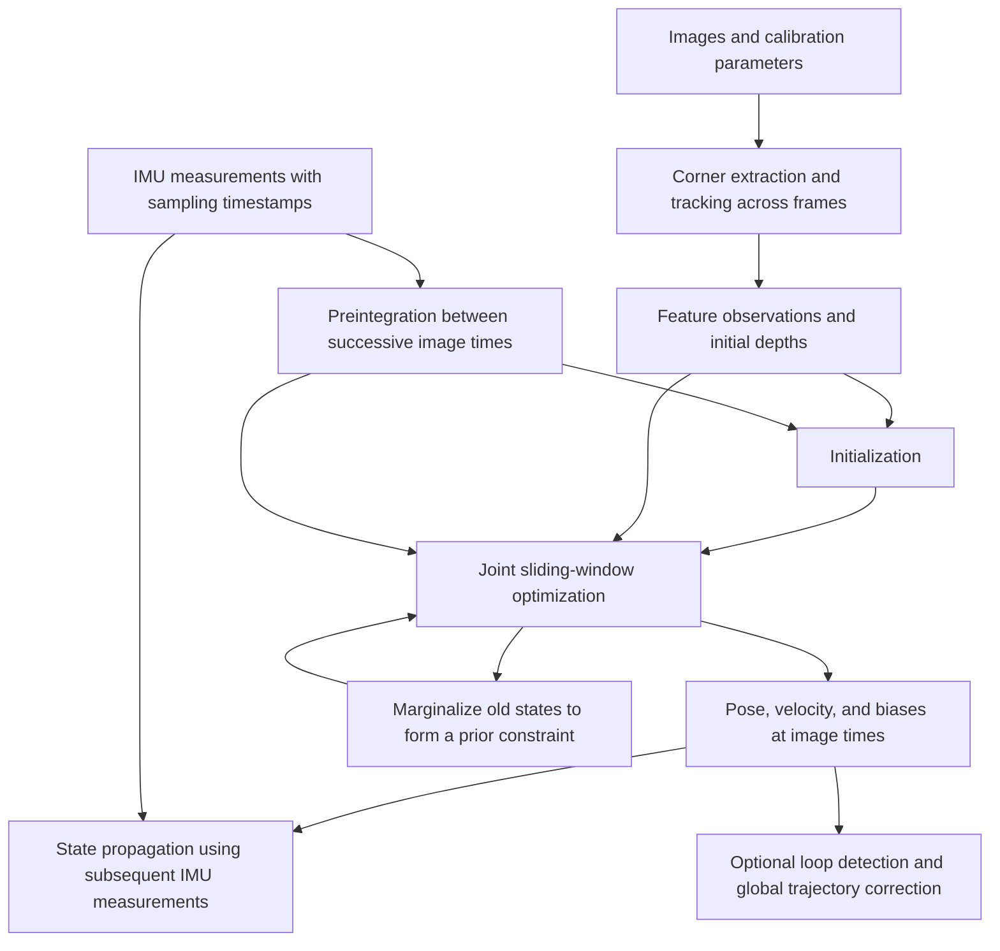

# VINS: How Visual-Inertial Odometry Works

Visual-inertial odometry combines successive images with inertial measurements to estimate the position, orientation, and velocity of the camera and IMU. The camera records the image positions of scene features, while the IMU measures angular velocity and specific force. The estimator continuously computes the sensors' motion state from the constraints relating these two measurement types. This chapter explains the process in data-processing order and relates it to the R680's existing visual-navigation system.

**VINS** stands for Visual-Inertial Navigation System; **VIO** means Visual-Inertial Odometry and emphasizes the continuous estimation of relative motion. This chapter introduces **VINS-Mono**, developed by the Hong Kong University of Science and Technology team, and its successor, **VINS-Fusion**. VINS-Mono uses monocular images and IMU measurements. VINS-Fusion supports three input combinations: monocular with IMU, stereo with IMU, and stereo without IMU. The last mode is visual odometry (VO). [VINS-Mono paper][s1], [official Fusion documentation][s3]

VINS-Fusion also provides optional visual loop-closure and GPS-fusion modules. This chapter belongs to T1, "Perception, Fusion, and Localization," and focuses on local odometry and loop-closure correction. Numerical values in the explanations are worked examples. R680 integration requirements are given in Section 8; build and run instructions are in [R680 VINS-Fusion Offline Evaluation][project]. VINS-Fusion is abbreviated to Fusion below.

---

# Process Overview

The camera acquires successive images, while the IMU usually samples at a higher rate. Before using these data, check measurement units and coordinate definitions, establish a common time base, and determine the relative mounting transform between the camera and IMU (Section 1).

The image-processing front end extracts corners and tracks them in subsequent images. In stereo mode, it also establishes correspondences between left and right images acquired at the same instant. These operations provide observations of the same spatial point in different images (Section 2).

The system preintegrates IMU measurements between successive image times to compute relative rotation, velocity increments, and position increments for subsequent optimization (Section 3). At startup, initialization must also provide initial values for motion states, feature depths, and gravity direction. Monocular and stereo modes use different initialization procedures (Section 4).

After initialization, the optimization back end jointly estimates motion states and feature depths within a sliding window by minimizing visual and inertial residuals. Before an old state leaves the window, its constraints on the retained states are preserved through marginalization (Section 5). IMU measurements arriving between image updates can also propagate the motion state (Section 6).

When loop closure is enabled, the system recognizes revisited places and corrects accumulated drift using loop constraints (Section 7). Finally, the chapter relates the input requirements and the purposes of the three offline evaluation groups, A/B/C, to the R680 sensor configuration (Section 8).

---

# 1. Input Measurements, Coordinate Frames, and Time Synchronization

## 1.1 Image Observations and Inertial Measurements

A single image records the pixel positions of spatial points. With known camera intrinsics, a pixel position can be converted into an observation direction, but it does not determine the point's distance from the camera. After a monocular camera translates, observations from multiple frames can recover scene structure and camera motion. However, scaling both the scene structure and camera translations by the same factor leaves the projections unchanged. The ratio between visual reconstruction units and physical length is called **scale**. Stereo determines scale from its calibrated camera baseline; monocular--IMU estimation must infer scale using inertial constraints during motion. [VINS-Mono, Sections I and V][s1]

An IMU, or inertial measurement unit, usually contains a three-axis gyroscope and a three-axis accelerometer. The gyroscope measures angular velocity in rad/s. The accelerometer measures **specific force** in m/s²: the non-gravitational force per unit mass. When a vehicle rests on level ground, the supporting force corresponds to an upward specific force of approximately 9.81 m/s², while the vehicle's translational acceleration is zero. VINS expects accelerometer measurements without gravity removal and accounts for gravity separately in its motion model. [VINS-Mono, Section IV-B][s1], [official device requirements][mono-device]

Both gyroscope and accelerometer measurements have **biases**. For example, a gyroscope's mean output may differ from zero even when the true angular velocity is zero. Biases generally vary slowly with temperature and time, whereas random noise produces short-term sample fluctuations. Because bias errors accumulate through integration, VINS estimates biases together with the motion states. For a constant acceleration error of 0.05 m/s² projected onto a fixed world direction, integrating for 10 s produces approximately 2.5 m of position error if other errors and observation corrections are ignored. [Preintegration paper, Sections V--VI][s2]

## 1.2 Coordinate Frames and Extrinsic Definitions

This chapter uses the world frame $w$ as the reference for motion estimation, $b$ for the IMU frame, and $c$ for the camera optical frame. The camera optical convention usually has $x$ pointing right, $y$ down, and $z$ forward. IMU axes are device-defined. The relative positions and orientations of the camera, IMU, and chassis must be measured or calibrated.

Let $R_{wb}$ denote the rotation matrix that transforms a vector from the IMU frame into the world frame, and let $\mathbf p_{wb}$ be the IMU origin's position in the world frame. Denote the fixed camera-to-IMU extrinsics by $R_{bc}$ and $\mathbf t_{bc}$: the rotation from the camera frame to the IMU frame and the camera origin's position in the IMU frame, respectively. A point with camera coordinates $\mathbf P_c$ is transformed into world coordinates as

$$
\mathbf P_w=R_{wb}(R_{bc}\mathbf P_c+\mathbf t_{bc})+\mathbf p_{wb}.
$$

This equation first transforms the point from the camera frame to the IMU frame, then into the world frame. Sensor origins usually differ from the vehicle reference point, and these points follow different trajectories during a turn. Before using a sensor pose for navigation, apply the mounting extrinsics to obtain the vehicle reference-point pose, consistent with the actual definition of `base_footprint`. [VINS-Mono, Sections III and VI][s1], [Fusion extrinsics and projection factor][s8]

This chapter defines the world $z$ axis as upward, with gravitational acceleration $\mathbf g_w=(0,0,-9.81)^{\mathsf T}$. Let $\tilde{\mathbf f}$ denote the accelerometer measurement and $\mathbf b_a$ its bias. Ignoring random noise, the translational acceleration of the IMU origin in the world frame is

$$
\mathbf a_w=R_{wb}(\tilde{\mathbf f}-\mathbf b_a)+\mathbf g_w.
$$

If the vehicle is stationary, the IMU axes align with the world axes, and bias is zero, the accelerometer reads $(0,0,9.81)$. Adding $\mathbf g_w$ then gives zero translational acceleration. The rest of this chapter follows this sign convention. Some papers and implementations define the gravity vector in the opposite direction and accordingly subtract it in the motion equation; check the convention against the measurement model. [Preintegration paper, Section V][s2]

## 1.3 Time Synchronization and Extrinsic Calibration

When processing an image timestamped $t_j$, the estimator needs IMU measurements spanning the motion between successive image times. A 20 Hz camera and 200 Hz IMU yield approximately 10 IMU samples between images. Timestamps determine the actual integration interval, and its boundaries also require appropriate handling. After accounting for the camera--IMU time offset, Fusion waits until IMU data cover the target image time, then extracts the corresponding measurement interval. [Fusion `processMeasurements`][s4]

The camera and IMU time bases may have an approximately fixed offset, usually denoted $t_d$, whose sign depends on the interface convention. Online temporal calibration can estimate that fixed offset, but it cannot remove random transmission delays that differ between serial messages. For example, at 1 rad/s, a 10 ms timing error corresponds to approximately 0.01 rad of rotation error. With a focal length of 400 pixels, this can shift a predicted projection near the image center by approximately 4 pixels. Timestamps should therefore represent the sensor's actual sampling instant as closely as possible. [Fusion time-offset support][s3], [temporal compensation in the projection factor][s8]

Camera--IMU extrinsics can be calibrated in advance and fixed, or optimized online during motion estimation. Online estimation requires motion that sufficiently constrains the unknown parameters. Ground vehicles mainly translate and rotate about the vertical axis, providing weak constraints on some extrinsics; extrinsics may also be difficult to distinguish from inertial biases. R680 should therefore first use fixed, previously calibrated extrinsics, then evaluate stereo VIO. [Official VINS-Mono extrinsic guidance][mono-device], [Fusion optimization parameter settings][s4]

---

# 2. Feature Extraction, Tracking, and Depth Estimation

## 2.1 Tracking Existing Features and Adding New Ones

The front end first extracts corners suitable for tracking. Moving an image patch along a straight edge may change its intensity distribution very little, making displacement in that direction difficult to determine. Intensity varies clearly in two directions around a corner, making correspondence between successive images easier to determine. **Optical flow** describes the motion of pixel positions over time; VINS uses sparse optical flow to estimate image displacements of selected features.

VINS-Mono tracks features with sparse KLT optical flow and adds corners when too few remain. The Fusion version cited here uses pyramidal Lucas--Kanade flow in `trackImage`: it estimates displacement at lower image resolution, then refines it through successive pyramid levels to accommodate larger image motion. When forward--backward consistency checking is enabled, the front end tracks current matches back into the preceding frame and checks their deviation from the original positions. It also rejects points outside the image and enforces a minimum feature spacing. [VINS-Mono, Section IV-A][s1], [Fusion feature front end][s5]

For example, feature 37 may be at $(320,210)$ in the previous frame and $(312,211)$ in the current frame. Retaining its identifier lets the back end associate both observations with the same spatial point. Dynamic objects, repeated texture, motion blur, and occlusion can cause incorrect associations, so geometric checks and optimization residuals are also needed to reject outliers. The VINS-Mono paper and Fusion source use somewhat different filtering procedures; check the actual version for the checks it performs. [Fusion feature front end][s5], [back-end outlier rejection][s4]

## 2.2 Stereo Matching and Triangulation

After tracking features across left-camera frames, stereo mode also searches for their correspondences in the right image acquired at the same instant. Temporal tracking connects observations from one camera at different times to constrain motion. Stereo matching connects simultaneous observations from two cameras and uses the known baseline to constrain feature depth. Feature identifiers associate both observation types. [Fusion feature front end][s5], [feature management][s6]

For rectified, horizontally aligned parallel pinhole cameras, the difference between a point's left and right image column coordinates is its disparity $d$. Given focal length $f_x$ and baseline length $B$, its depth $Z$ along the left camera's optical axis is

$$
Z=\frac{f_x B}{d}.
$$

With $f_x=400$ pixels, $B=0.05$ m, and $d=10$ pixels, the depth is $Z=2$ m. Because the baseline is measured in meters, the result has metric scale. Greater depth means smaller disparity, and the same disparity error produces a larger depth error. Fusion actually **triangulates** observation rays using the camera models and extrinsics; the equation above is a simplification for rectified parallel stereo. [Fusion `triangulate`][s6]

## 2.3 Inverse-Depth Feature Representation

Camera intrinsics convert pixel coordinates into observation directions. For an undistorted pinhole image with principal point $(c_x,c_y)$ and focal lengths $f_x,f_y$, normalized coordinates are $x=(u-c_x)/f_x$ and $y=(v-c_y)/f_y$. The vector $(x,y,1)$ gives the observation-ray direction; multiplying it by depth $Z$ gives the three-dimensional coordinates.

VINS references each feature to the camera frame in which it was first observed and parameterizes its three-dimensional position with **inverse depth** $\lambda=1/Z$:

$$
\mathbf P_c=\frac{1}{\lambda}(x,y,1)^{\mathsf T}.
$$

For $(x,y)=(0.2,-0.1)$ and $\lambda=0.5\,\mathrm{m}^{-1}$, the point coordinates are $(0.4,-0.2,2)$ m. Depth here is the coordinate along the camera $z$ axis, not Euclidean distance to the optical center. Given the observation direction in the reference frame, the back end updates the point's position by adjusting one inverse-depth parameter and computes its projections in other images. Distant features have inverse depths close to zero. Triangulation supplies an initial inverse depth, which subsequent optimization refines using multi-frame observations. [VINS-Mono, Sections VI-A and VI-C][s1], [Fusion inverse-depth access][s6]

Monocular triangulation requires camera translation to form a baseline between observation positions. Pure rotation changes feature pixels but supplies no such baseline. A stereo camera already has a fixed baseline at one instant, so valid matches can yield metric depth even while stationary. This is one reason monocular and stereo initialization differ.

---

# 3. IMU Integration and Preintegration

## 3.1 Computing Motion States from Inertial Measurements

After subtracting gyroscope bias $\mathbf b_g$, integrate angular velocity to update orientation. Transform bias-corrected specific force into the world frame, account for gravity, then integrate to update velocity and position. If world-frame acceleration $\mathbf a_w$ is approximately constant over a short interval $\Delta t$, then

$$
\mathbf v_j\approx\mathbf v_i+\mathbf a_w\Delta t,
\qquad
\mathbf p_j\approx\mathbf p_i+\mathbf v_i\Delta t+
\frac12\mathbf a_w\Delta t^2.
$$

For example, if a vehicle travels straight at 1 m/s and maintains a forward acceleration of 0.5 m/s² for the next 0.1 s, velocity increases by 0.05 m/s and displacement is approximately $0.1+0.0025=0.1025$ m. With a constant vertical-axis angular velocity of 0.2 rad/s over the same interval, the rotation is 0.02 rad, approximately 1.15°. Actual integration updates orientation at IMU sampling times and uses it to transform acceleration measurements. Fusion uses midpoint integration for preintegration. [Preintegration paper, Section V][s2], [Fusion preintegration implementation][s7]

## 3.2 Preintegration and Bias Correction

During optimization, the position, velocity, and orientation of frame $i$ are updated repeatedly. Reintegrating all IMU measurements over the interval after every update would greatly increase computation. Given a bias estimate, **preintegration** condenses measurements from $t_i$ to $t_j$ into three quantities expressed relative to the IMU frame at frame $i$: relative rotation $\Delta R_{ij}$, velocity increment $\Delta\mathbf v_{ij}$, and position increment $\Delta\mathbf p_{ij}$. They do not depend on the initial world position, velocity, or orientation and can be reused across optimization iterations. [Preintegration paper, Section VI][s2]

Let $R_i=R_{wb_i}$. States at the interval endpoints should approximately satisfy

$$
\begin{aligned}
R_j&\approx R_i\Delta R_{ij},\\
\mathbf v_j&\approx\mathbf v_i+\mathbf g_w\Delta t+
R_i\Delta\mathbf v_{ij},\\
\mathbf p_j&\approx\mathbf p_i+\mathbf v_i\Delta t+
\tfrac12\mathbf g_w\Delta t^2+R_i\Delta\mathbf p_{ij}.
\end{aligned}
$$

After updating the initial state, the back end can use these relations to recompute the predicted endpoint state without reintegrating every measurement. Preintegrated velocity and position increments are computed from specific force. After rotation into the world frame by the initial rotation matrix, the contributions of initial velocity and gravity are included as appropriate.

Preintegrated quantities still depend on the bias estimate. The system retains their Jacobians with respect to bias to describe the first-order effects of small bias changes. After a bias update, it can apply a first-order correction and reintegrate if necessary. Bias evolution is commonly modeled as a random walk. Joint optimization can thus use visual observations to update biases and correct inertial constraints accordingly. [Preintegration paper, Section VI-C][s2], [Fusion `IntegrationBase`][s7]

Preintegration also propagates measurement uncertainty. Measurement noise and integration duration affect the preintegration covariance. Missing samples and abnormal time intervals must be identified separately during input checks; covariance propagation alone does not handle them.

The cited configuration example labels `acc_n/gyr_n` as measurement-noise standard deviations and `acc_w/gyr_w` as bias random-walk noise standard deviations. Calibration tools may instead output continuous-time noise densities. When setting parameters, check each quantity's units and the code's discretization, and convert according to their definitions. ROS message covariance, noise standard deviation, and noise density are not directly interchangeable. Section 5 uses the preintegration covariance to weight inertial residuals. [Official parameter example][s14], [preintegration implementation][s7], [IMU factor][s9]

---

# 4. Initializing Motion States and Scale

## 4.1 Monocular Reconstruction and Visual-Inertial Alignment

Joint visual-inertial optimization is nonlinear. Large initial errors can cause failed convergence or incorrect estimates. **Initialization** supplies reasonable initial values for poses, feature depths, velocities, gravity direction, and other unknowns so that subsequent optimization can converge reliably.

VINS-Mono first collects images with common features and sufficient parallax, then uses Structure from Motion (SfM) to estimate camera poses and three-dimensional points. The visual reconstruction still has unknown scale. The system next estimates gyroscope bias from the relative rotations obtained by vision and IMU, then relates visual translation to IMU preintegration to solve for per-frame velocities, gravity direction, and scale. It refines gravity direction using the known gravity magnitude. After visual-inertial alignment, the reconstruction is converted to metric scale and enters sliding-window optimization. Accelerometer bias and gravity direction are strongly coupled and difficult to separate during brief initialization, so bias must still be estimated in subsequent optimization. [VINS-Mono, Section V][s1]

For example, one unit in a monocular reconstruction may correspond to 0.5 m or 2 m. Inertial measurements with sufficiently varied motion are needed to determine physical scale and separate the effects of velocity, gravity, and bias. During prolonged rest, pure rotation, or insufficient acceleration variation, adding images may not supply the missing constraints. For a ground vehicle, assess initialization using its motion type, extrinsics, and IMU quality; planar motion alone does not determine whether initialization will be usable.

## 4.2 Stereo Initialization

A stereo camera triangulates synchronized image pairs to obtain three-dimensional points at metric scale. Camera pose can then be estimated from those points and their two-dimensional correspondences in subsequent images, a problem called PnP (Perspective-n-Point). In stereo--IMU mode, the cited Fusion version performs PnP and triangulation frame by frame. Once the window contains the prescribed number of image frames, it estimates gyroscope bias, recomputes preintegration with that bias, and begins joint optimization. Initial IMU orientation is also aligned with gravity using the mean direction of an interval of accelerometer measurements; motion acceleration and bias at startup therefore affect the initial orientation. [Fusion `initFirstIMUPose` and `processImage`][s4]

Stereo-only mode likewise uses PnP, triangulation, and visual optimization, but contains no IMU preintegration or inertial-bias states. The stereo baseline already provides scale, so stereo initialization does not require the monocular inertial scale-recovery procedure. On R680, stereo VO can first verify image synchronization, camera calibration, and feature tracking; IMU data can then be added to evaluate inertial constraints. Stereo VIO still requires adequate time synchronization, inertial-bias estimation, and camera--IMU extrinsics.

## 4.3 World Frame and Unobservable Degrees of Freedom

Without GPS, a known map, or another external reference, translating the entire trajectory and reconstructed scene, or rotating them together about gravity, leaves the image--IMU measurement relations unchanged. Under general non-degenerate motion, conventional VIO therefore retains four globally unobservable degrees of freedom: translation in $x,y,z$ and yaw about gravity. The system selects a world origin and initial heading and reports motion in that reference frame. Gravity supplies roll and pitch references, while inertial constraints or a stereo baseline provide scale. Absolute geographic position and true north still require an external reference. [VINS-Mono, Sections VII--VIII][s1]

Stereo-only VO has metric scale but no gravity reference. Applying any common three-dimensional translation and rotation to the trajectory and scene leaves the image observations unchanged, giving six globally unobservable degrees of freedom. The loop-closure graph optimization in Section 7 reflects this difference.

---

# 5. Joint Visual-Inertial Sliding-Window Optimization

## 5.1 State Variables and Feature Parameters

After initialization, the system jointly estimates states at a limited number of image times. These states and their observations, updated over time, form the **sliding window**. At each image time, the IMU state includes position, orientation, velocity, accelerometer bias, and gyroscope bias; features are represented by inverse depth. With online calibration enabled, camera--IMU extrinsics and the time offset can also be estimated. [VINS-Mono, Section VI-A][s1], [Fusion `optimization`][s4]

For example, a window retaining 11 successive image times separated by 0.05 s spans approximately 0.5 s of motion. New observations can simultaneously correct the current state, several preceding states, and feature depths. The actual temporal span depends on frame rate and keyframe selection. Local-window states and the long-term keyframes retained for loop closure are managed separately.

## 5.2 Visual Reprojection Residuals

Given the current state estimate, a three-dimensional point is recovered from its reference-frame observation direction and inverse depth. Camera--IMU extrinsics and the poses at both times transform it into the current camera frame. Let $\pi$ denote the projection function, $\mathbf z_{lj}$ the feature observation in the current image, and $\mathbf P_{c_j}$ the point's estimated coordinates in the current camera frame. The visual residual can be written as

$$
\mathbf r_{V,lj}=\pi(\mathbf P_{c_j})-\mathbf z_{lj}.
$$

Here, $l$ identifies the feature and $j$ the observation frame. The residual is predicted projection minus observed position. Both must use the same coordinate representation: implementations may use errors on a normalized plane or the tangent plane of the unit sphere, so residuals are not necessarily measured in pixels. Stereo mode adds right-camera observations, jointly using simultaneous stereo and temporal observations to constrain depth and pose. If extrinsics are estimated, these observations also constrain them. [VINS-Mono, Section VI-C][s1], [Fusion projection factor][s8]

For example, an observation at $(312,211)$ and an estimated projection at $(315,210)$ give the pixel-coordinate residual $(3,-1)$. The solver can reduce it by adjusting pose or feature depth. Because each state usually participates in several visual observations and inertial constraints, the optimizer must consider them jointly rather than solve for one point alone.

## 5.3 IMU Preintegration Residuals and Tight Coupling

An IMU preintegration residual measures the difference between the motion implied by the states at both interval endpoints and the preintegrated measurement. For example, the velocity residual is

$$
\mathbf r_{I,v}=R_i^{\mathsf T}
(\mathbf v_j-\mathbf v_i-\mathbf g_w\Delta t)
-\Delta\mathbf v_{ij}.
$$

The parenthesized expression subtracts gravity's contribution from the world-frame velocity change. Multiplication by $R_i^{\mathsf T}$ transforms it into the IMU frame at time $i$ for comparison with the preintegrated velocity increment. Position, rotation, and bias changes also produce residuals; the complete computation includes bias correction of preintegrated quantities. Together, these residuals constrain position, orientation, velocity, and biases at both times. [Preintegration paper, Section VII][s2], [Fusion IMU factor][s9]

Joint state estimation from image features and inertial data at the measurement level is called **tight coupling**. In VINS, visual and preintegration residuals constrain the same state variables: visual observations can affect inertial-bias estimates, whose updates alter preintegration constraints, while inertial measurements help distinguish rotation and translation in image motion. If visual poses are first estimated independently and then fused by an external filter, coupling occurs at the estimate level. Tight coupling describes the fusion level and is a separate classification from filtering versus optimization; a filter that directly processes image features can also be tightly coupled. [VINS-Mono, Sections II and VI][s1]

## 5.4 Joint Objective and Iterative Solution

Let $\mathcal X$ be the set of estimated states and feature parameters, and $\mathbf r_P$ the prior residual from earlier marginalization. The joint objective can be summarized as

$$
\min_{\mathcal X}
\left\{
\|\mathbf r_P\|_{\Sigma_P}^{2}
+\sum_{(i,j)}\|\mathbf r_{I,ij}\|_{\Sigma_{I,ij}}^{2}
+\sum_{(l,j)}\rho\!\left(
\|\mathbf r_{V,lj}\|_{\Sigma_{V,lj}}^{2}\right)
\right\}.
$$

Here, $\|\mathbf r\|_\Sigma^2=\mathbf r^{\mathsf T}\Sigma^{-1}\mathbf r$, where $\Sigma$ is the covariance of the corresponding residual. Covariance weighting scales residuals with different units and reflects measurement uncertainty in their weights. The function $\rho$ is a robust loss. Fusion applies a Huber loss to visual residuals, reducing the relative influence of large residuals and limiting the effect of a small number of outliers. Robust loss cannot eliminate systematic incorrect associations; an incorrect estimate is still possible when, for example, many features belong to moving objects. [VINS-Mono, Equation 22][s1], [Fusion `optimization`][s4]

The solver linearizes residuals around the current estimate, computes state increments, and updates the estimate iteratively to reduce the joint objective. Because measurements contain noise, all residuals generally cannot be reduced to zero simultaneously. Stereo-only mode removes the IMU residuals and inertial states, retaining visual sliding-window optimization.

## 5.5 Retaining Historical Constraints through Marginalization

Retaining every historical state in optimization would increase the variable count and computational cost over time. The estimator bounds the problem size by removing selected states from its sliding window. Before removal, it converts the associated observations' constraints on retained variables into a prior, a process called **marginalization**. This retains some historical information instead of simply deleting a state and all its constraints. [VINS-Mono, Section VI-D][s1]

Consider states A, B, and C at three times. Before removing A, linearize the relevant residuals around the current estimate and eliminate A's variables from the linear system, retaining an approximate constraint on B and C. This elimination uses the **Schur complement**.

Let $m$ denote variables to remove, $r$ retained variables, and $H$ the information matrix in the normal equations after residual linearization. With corresponding blocks $H_{mm},H_{mr},H_{rm},H_{rr}$, the prior information matrix is

$$
H_{\mathrm{prior}}=H_{rr}-H_{rm}H_{mm}^{-1}H_{mr}.
$$

The right-hand-side vector of the normal equations requires corresponding elimination; the implementation also handles near-zero eigenvalues. The marginalized prior retains some constraints from the old states on the remaining variables, but depends on the linearization point used at marginalization. Subsequent optimization cannot use that prior to relinearize all removed original observations. [Fusion marginalization implementation][s10]

VINS chooses its window update based on parallax and tracking. When a new keyframe should be retained, it marginalizes the oldest state. Otherwise, it can remove a non-keyframe state near the end of the window and merge adjacent IMU intervals. The branches retain associated constraints in different ways. The loop-closure module separately stores long-term keyframes and is not limited by local-window length. [VINS-Mono, Sections IV-A and VI-D][s1], [Fusion `slideWindow`][s4]

---

# 6. State Output and Visual-Tracking Validity

After each image optimization, the estimator has position, orientation, velocity, and bias estimates for that time. Time-ordered poses form a trajectory, and the system can also publish odometry, feature points, and camera poses. Before integration with navigation, verify which states the output interface provides, which sensor frame the pose describes, its reference frame, and the frame in which velocity is expressed. The official standalone node expresses linear velocity in the world frame; an interface requiring body-frame velocity needs a corresponding transformation. [Fusion output implementation][s12]

Because IMU measurements usually arrive faster than images, the official standalone estimator also provides high-rate state prediction. Starting from the latest optimized state, it uses subsequent IMU measurements for **state propagation**. After the next image optimization, propagation is recomputed from the corrected state. High-rate propagation improves output time resolution, but adds no new visual constraint between image updates. [VINS-Mono, Section VI-F][s1], [Fusion `inputIMU` and `fastPredictIMU`][s4]

After camera occlusion, IMU measurements and predicted outputs may continue, but pure inertial-propagation error accumulates over time. To assess visual tracking, check whether the current image was processed, whether image timestamps continue advancing, the current valid-feature and inlier counts, and whether the system is initializing or resetting. Continued inertial prediction or historical features remaining in the window do not establish that the current image supplies valid visual constraints. [VINS-Mono, Sections VI-E and VI-F][s1], [project visual-health handling][project]

Groups B/C in this project call Fusion through an RTAB-Map wrapper and record odometry and visual-tracking status at image times. This differs from the official standalone high-rate prediction interface. To determine whether the output is suitable for navigation and control, also check input timing, coordinate transforms, covariance, and actual publication frequency. [Project wrapper and output documentation][project]

---

# 7. Loop Detection and Global Trajectory Correction

The local sliding window has bounded computational size, but long runs still accumulate drift. **Loop detection** recognizes a revisited place and links the current trajectory to historical states. VINS retains keyframe feature descriptors, retrieves loop candidates by comparing current and historical images, then verifies them using feature correspondences and a geometric solution. Visually similar scenes can be different places, so image similarity alone does not confirm a loop. [VINS-Mono, Section VII][s1], [Fusion `detectLoop`][s11], [`findConnection`][s13]

After verification, the loop's relative pose is added as a constraint to a **pose graph**. Nodes represent keyframe poses; edges represent local motion or loop constraints. For example, after returning to the start of a closed route, local odometry may place the endpoint 0.3 m from the start. A valid loop constraint supplies the relative relationship between the revisited and historical positions. Graph optimization jointly adjusts the relevant keyframe poses to reduce trajectory inconsistency.

After gravity alignment, VINS-Mono pose-graph optimization corrects three-dimensional position and yaw, a total of **4 degrees of freedom**; gravity constrains roll and pitch. The Fusion version cited here selects its graph optimization using `use_imu`: VIO uses 4-DoF optimization, while pure VO uses **6-DoF** optimization, adjusting both three-dimensional position and rotation. [VINS-Mono, Section VIII][s1], [Fusion `setIMUFlag`][s11]

Global graph optimization corrects historical poses and updates the local-to-global transform, while local odometry used for control normally needs continuity. In ROS, `odom` represents continuous local motion and `map` represents the global pose corrected by localization or loop closure. Integration must explicitly assign each TF transform to its publisher. Loop closure constrains drift relative to the historical trajectory, but absolute geographic position and true north still require external references. [Fusion drift-transform update][s11], [project TF responsibilities][project]

VINS sparse features and pose graph primarily support motion estimation and trajectory correction. Other modules must provide obstacle representations, traversable areas, and path planning. R680 must therefore retain its existing depth-obstacle processing, occupancy mapping, map localization, and path-planning modules. The official Fusion system has optional loop closure; this project's B/C offline experiments evaluate odometry only. [Official Fusion run instructions][s3], [visual-navigation runtime chapter][textbook]

---

# 8. R680 Integration Requirements and Validation Methods

## 8.1 Existing Fusion Approach and A/B/C Comparative Experiments

The R680's current RGB-D input pairs a left infrared image captured with the projector off with a depth image generated at an adjacent time with the projector on. Wheel odometry can provide a motion prediction for visual matching; an external EKF then fuses the velocity output from visual odometry, wheel velocity, and gyroscope measurements to produce `/odom` for navigation. Introducing VINS primarily changes the internal odometry estimator: image features form visual residuals, full IMU measurements form preintegration residuals, and both residual types jointly constrain states within the same window. [Visual-navigation runtime chapter, Sections 1–2][textbook]

The project's offline evaluation tools provide three configurations: A reproduces the current RGB-D visual odometry, wheel velocity, and EKF approach; B uses Fusion stereo-only VO; C uses the same stereo input and adds full IMU measurements. A/B compares the overall performance of the two visual-odometry and fusion configurations, while B/C assesses the benefit of inertial constraints. All three groups should replay the same original recorded bag, with stability assessed using multiple recordings and repeated experiments. Trajectory error can be computed when independent ground truth is available; otherwise, report metrics such as endpoint error on a closed route and repeatability. [Offline evaluation documentation][project]

## 8.2 Stereo Synchronization and Projector-State Filtering

The R680 currently disables right infrared image output by default; recording stereo data requires explicitly enabling `record_stereo:=true`. Groups B/C require left and right infrared images captured at the same instant, and input checks pair them by exact equality of their original integer nanosecond timestamps. The existing RGB-D pairing combines infrared and depth images from adjacent frames and cannot directly construct synchronized stereo input. [Project recording and synchronization constraints][project]

The speckle pattern produced by the infrared projector is not fixed to the scene: its position on object surfaces changes as the camera moves, potentially interfering with static-scene feature tracking. The current experiments use only left/right image pairs classified as captured with the projector off. If the raw infrared frame rate is 30 Hz and the projector alternates on and off every frame, the nominal rate of frames with the projector off is approximately 15 Hz; dropped frames, synchronization, and filtering further affect the usable rate. Official VINS-Mono guidance recommends image rates above 20 Hz and IMU rates above 100 Hz. The current nominal image rate is below that recommendation, so Fusion's tracking capability and real-time performance still require measurement. [Official device recommendations][mono-device], [project frame filtering][project]

When image metadata lack projector state, the tools can classify frames heuristically using infrared speckle characteristics and the proportion of valid depth pixels. Experiment records should state the classification method and effective frame rate after filtering; indirect classification results cannot serve as evidence of hardware state or hardware synchronization. Misclassifying projector state affects static-feature tracking, while unsynchronized left and right images make stereo geometry inconsistent with the actual motion. [Project recording notes][project]

## 8.3 IMU Timing Quality, Wrapper Limitations, and Extrinsic Checks

The current chassis reference driver calls `now()` to timestamp serial data after the host receives them; this does not establish the sensor's actual sampling instant. Group C therefore rejects inputs whose timestamp source is `host_receive`; declaring the source as `sensor` requires evidence of a sensor sampling clock. Input must also contain raw three-axis accelerometer and three-axis angular-velocity measurements, have a rate strictly above 100 Hz, and pass stationary-data, sampling-interval, and TF checks. These conditions are conservative admission criteria for this project, not general Fusion hardware specifications, and they do not replace time synchronization or sensor calibration. [Project group C admission criteria][project]

The RTAB-Map version used in this project forwards to Fusion only IMU data near the current image time. A nonzero time offset may require the estimator to wait for later IMU measurements. The current wrapper incompletely supports this scheduling requirement, so the experiments fix `td=0, estimate_td=0` and require verified input time synchronization. If calibration finds a nonzero offset, correct the input time base, or modify and validate the data-scheduling mechanism, before running experiments. Fusion itself supports online time-offset estimation; this limitation comes from the wrapper used here. [Project wrapper limitations][project], [Fusion temporal-calibration support][s3]

Extrinsics in the configuration and TF should agree. `body_T_cam0/1` represents the transforms from the left/right rectified camera optical frames to the IMU frame, in the same direction as $R_{bc},\mathbf t_{bc}$ in Section 1.2. Because the current RTAB-Map back end sets camera–IMU extrinsics from TF, check the calibration results, configuration matrices, and actual TF together, and confirm that they refer to the rectified optical frames. D435i example parameters and nominal CAD poses cannot replace calibration of this vehicle. [Project extrinsic checks][project]

The project has implemented offline evaluation tools and input checks, but ROS compilation, physical sensor calibration, and localization-performance validation on the R680 are still incomplete. See the [offline evaluation documentation][project] for build, bag-recording, data-audit, replay, and metric-computation procedures.

## 8.4 Further Integration of Wheel Measurements

Wheel encoders on ground vehicles can provide additional motion measurements. The [VIWO paper][viwo] included in this repository incorporates wheel measurements into visual-inertial estimation: it jointly constrains scale and inertial states during initialization, uses inertial–wheel constraints during propagation and optimization, and exploits approximately planar motion. Wheel measurements thus participate directly in the estimator's internal state solution, at a different stage from fusing wheel velocity in an external EKF after VIO output. [VIWO, Sections III–IV][viwo]

Wheel measurements can supplement motion information when visual constraints are weak, but their validity depends on encoder scale, mounting extrinsics, the chassis motion model, and ground-contact conditions. Wheel slip makes wheel velocity diverge from actual vehicle motion, and approximate planar constraints apply only under suitable surface conditions. Experimental results from other robots or public datasets provide reference information only. For the R680, analyze input quality and errors in groups A/B/C before deciding whether to add wheel constraints to initialization or sliding-window optimization.

If VIO already uses the chassis IMU, its output is correlated with the raw gyroscope measurements. An external EKF that fuses both as independent observations may count inertial information twice and underestimate output uncertainty. Before deployment, redesign the fusion inputs; check the frame in which velocity is expressed, the pose transform from the IMU to the vehicle reference point, and output covariance; and assign a unique publisher for navigation odometry and each TF transform. [Project notes on subsequent integration][project]

---

# References and Suggested Source-Code Reading Order

| Reference or source code | Suggested reading |
| --- | --- |
| [Qin, Li, and Shen: VINS-Mono][s1], IEEE TRO, 2018; DOI `10.1109/TRO.2018.2853729` | Section IV: measurement preprocessing; Section V: initialization; Section VI: sliding window and marginalization; Sections VII–VIII: relocalization and 4-DoF graph optimization. |
| [Forster et al.: On-Manifold Preintegration for Real-Time Visual-Inertial Odometry][s2]; DOI `10.1109/TRO.2016.2597321` | Read the derivations of rotation preintegration, uncertainty propagation, and bias correction, and check their coordinate and gravity conventions. |
| [Official VINS-Fusion README][s3] | Supported sensor combinations, online calibration capabilities, and optional loop-closure module. |
| [`feature_tracker.cpp`][s5] → [`feature_manager.cpp`][s6] | Optical-flow tracking, stereo matching, triangulation, PnP, and inverse-depth management. |
| [`estimator.cpp`][s4] → [`integration_base.h`][s7], [IMU factor][s9], [projection factor][s8] | Initialization branches and `optimization`, plus computation of preintegration, inertial residuals, and visual residuals. |
| [`marginalization_factor.cpp`][s10] → [`pose_graph.cpp`][s11], [`keyframe.cpp`][s13] | Local-window marginalization, loop verification, and 4/6-DoF pose-graph optimization. |
| [Project offline evaluation documentation][project], [existing visual-navigation runtime chapter][textbook], [VIWO full text][viwo] | R680 input requirements and wrapper limitations, the existing EKF configuration, and methods for incorporating wheel measurements into visual-inertial estimation. |

All Fusion source-code references in this chapter correspond to commit `be55a937a57436548ddfb1bd324bc1e9a9e828e0`. The project documentation separately records the ROS 2 port, RTAB-Map version, and patches used in the R680 experiments. References checked on 2026-10-24.

[s1]: https://arxiv.org/abs/1708.03852
[s2]: https://arxiv.org/abs/1512.02363
[s3]: https://github.com/HKUST-Aerial-Robotics/VINS-Fusion/blob/be55a937a57436548ddfb1bd324bc1e9a9e828e0/README.md
[s4]: https://github.com/HKUST-Aerial-Robotics/VINS-Fusion/blob/be55a937a57436548ddfb1bd324bc1e9a9e828e0/vins_estimator/src/estimator/estimator.cpp
[s5]: https://github.com/HKUST-Aerial-Robotics/VINS-Fusion/blob/be55a937a57436548ddfb1bd324bc1e9a9e828e0/vins_estimator/src/featureTracker/feature_tracker.cpp
[s6]: https://github.com/HKUST-Aerial-Robotics/VINS-Fusion/blob/be55a937a57436548ddfb1bd324bc1e9a9e828e0/vins_estimator/src/estimator/feature_manager.cpp
[s7]: https://github.com/HKUST-Aerial-Robotics/VINS-Fusion/blob/be55a937a57436548ddfb1bd324bc1e9a9e828e0/vins_estimator/src/factor/integration_base.h
[s8]: https://github.com/HKUST-Aerial-Robotics/VINS-Fusion/blob/be55a937a57436548ddfb1bd324bc1e9a9e828e0/vins_estimator/src/factor/projectionTwoFrameTwoCamFactor.cpp
[s9]: https://github.com/HKUST-Aerial-Robotics/VINS-Fusion/blob/be55a937a57436548ddfb1bd324bc1e9a9e828e0/vins_estimator/src/factor/imu_factor.h
[s10]: https://github.com/HKUST-Aerial-Robotics/VINS-Fusion/blob/be55a937a57436548ddfb1bd324bc1e9a9e828e0/vins_estimator/src/factor/marginalization_factor.cpp
[s11]: https://github.com/HKUST-Aerial-Robotics/VINS-Fusion/blob/be55a937a57436548ddfb1bd324bc1e9a9e828e0/loop_fusion/src/pose_graph.cpp
[s12]: https://github.com/HKUST-Aerial-Robotics/VINS-Fusion/blob/be55a937a57436548ddfb1bd324bc1e9a9e828e0/vins_estimator/src/utility/visualization.cpp
[s13]: https://github.com/HKUST-Aerial-Robotics/VINS-Fusion/blob/be55a937a57436548ddfb1bd324bc1e9a9e828e0/loop_fusion/src/keyframe.cpp
[s14]: https://github.com/HKUST-Aerial-Robotics/VINS-Fusion/blob/be55a937a57436548ddfb1bd324bc1e9a9e828e0/config/euroc/euroc_stereo_imu_config.yaml
[mono-device]: https://github.com/HKUST-Aerial-Robotics/VINS-Mono#5-run-with-your-device
[project]: #local-project-document
[textbook]: #local-textbook-document
[viwo]: #local-viwo-source

## Local reference paths

These files are available in the local workspace and are not distributed
with the public literature repository.

### Local project document

`../../wheeltec-ros-source-reference/ros2/navigation/vision-nav/wheeltec_vision_nav/VINS.md`

### Local textbook document

`../../wheeltec-ros-textbook/docs/06-sensors-navigation/38-visual-runtime.md`

### Local VIWO source

`../02-fulltext/T1-perception-localization/2024-VIWO-MAP-M24/paper.md`
